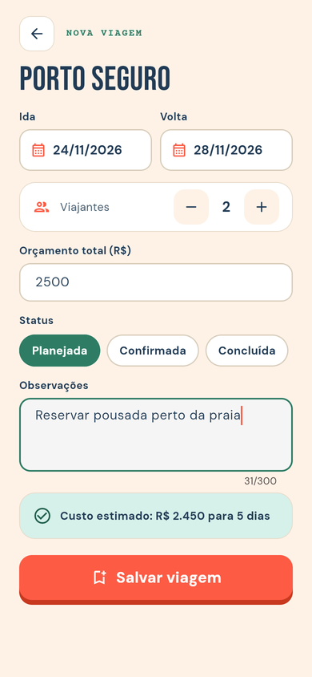
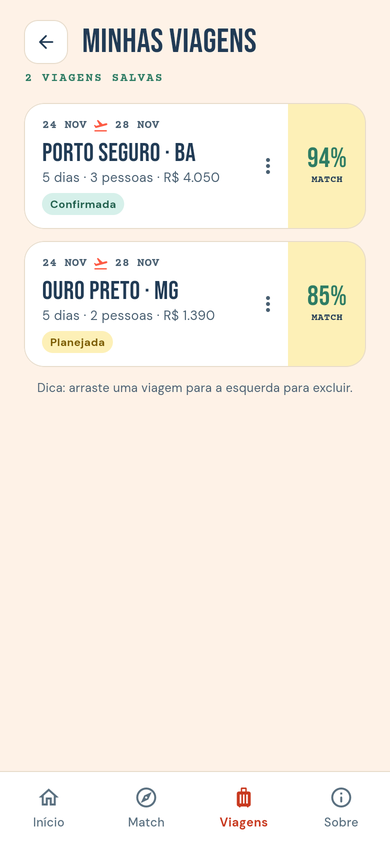
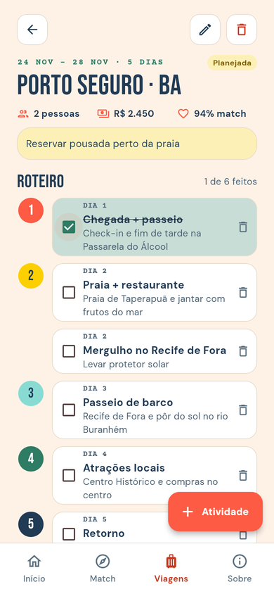
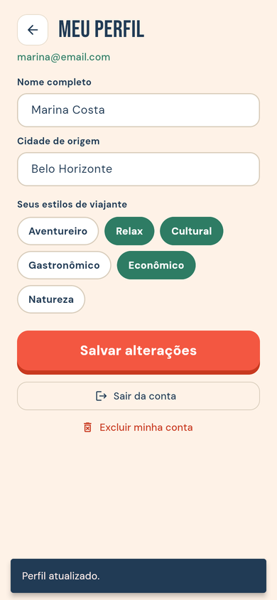

<div align="center">


### Planeje melhor. Viaje mais.

Aplicativo de recomendação e planejamento personalizado de viagens.


</div>

---

## Comece por aqui

| Quero… | Abra |
|---|---|
| **Instalar tudo do zero e rodar o app** (Windows, passo a passo) | 📘 [Manual de instalação](docs/INSTALACAO.md) |
| **Apresentar o app em aula** no celular virtual e provar que os dados ficam salvos | 🎤 [Manual de demonstração](docs/DEMONSTRACAO.md) |
| **Entender o banco de dados** (tabelas e CRUD) | 🗄️ [Banco de dados](docs/BANCO_DE_DADOS.md) |
| **Ver as entregas** de cada sprint (PDFs) | 📄 [Entregas](#entregas) |

**Já tem o Flutter instalado?** Então são só três comandos:

```powershell
git clone https://github.com/tbahiasantos/tripwise.git
cd tripwise
flutter pub get
flutter run -d chrome          # ou: flutter run -d emulator-5554 (celular virtual)
```

---

## Sobre o projeto

A maioria dos apps de viagem começa pela pergunta *“para onde você quer ir?”*. O **TripWise** inverte essa lógica: o usuário informa **perfil, preferências, orçamento e período**, e o app encontra os destinos mais compatíveis, com estimativa de custos e roteiro sugerido.

> **O usuário não precisa saber para onde quer ir. Ele só precisa saber como quer viajar.**

```text
Perfil + Preferências + Orçamento + Período
                    │
                    ▼
              Travel Match  ──►  destinos ordenados por % de compatibilidade
                    │
                    ▼
     Estimativa de gastos  ──►  Viagem salva  ──►  Roteiro dia a dia
```

## Telas

| Início | Cadastro | Home | Preferências |
|:---:|:---:|:---:|:---:|
|  |  |  |  |
| **Travel Match** | **Destino** | **Planejar viagem** | **Minhas viagens** |
|  |  |  |  |
| **Viagem + roteiro** | **Perfil** | **Sobre** | |
|  |  |  | |

## O que o app faz

**Conta e sessão**
- Cadastro com perfil de viajante, login e perfil editável (dá para excluir a conta)
- O app lembra quem está logado, mesmo depois de fechado

**Travel Match**
- Questionário: origem, orçamento, duração, viajantes, tipo de viagem e prioridade
- Ranking de destinos por **% de compatibilidade**, calculado com os dados do banco
- Detalhe do destino com motivos do match, estimativa de gastos e favorito (♥)

**Viagens**
- Planejar uma viagem (datas, pessoas, orçamento, status, observações)
- Listar, editar e excluir viagens
- Roteiro dia a dia: adicionar, editar, marcar como feita e excluir atividades

## Persistência de dados (Sprint 3)

- **SQLite** com `sqflite`: banco `tripwise.db` com **10 tabelas**, chaves estrangeiras e `ON DELETE CASCADE`
- **CRUD completo** em usuários, viagens e itens do roteiro
- **SharedPreferences** para a sessão do usuário logado
- Senhas guardadas como **hash SHA-256**, nunca em texto puro
- **Testes automáticos** do CRUD em banco em memória (`flutter test`)

Detalhes em **[docs/BANCO_DE_DADOS.md](docs/BANCO_DE_DADOS.md)**.

## Estrutura do código

```text
lib/
├── main.dart                # início do app (tema, idioma e rotas)
├── app_routes.dart          # rotas nomeadas e barra de abas
├── data/                    # banco SQLite, repositórios (CRUD) e sessão
├── models/                  # usuário, destino, viagem e preferências
├── screens/                 # uma tela por arquivo
├── theme/                   # cores, fontes e estilo visual
└── widgets/                 # componentes reutilizáveis (botões, cartões…)
assets/                      # fontes e logo
docs/                        # manuais, PDFs das entregas e prints
test/                        # testes automáticos
web/                         # versão web (inclui o SQLite para navegador)
android/                     # versão Android
```

## Comandos úteis

| Comando | O que faz |
|---|---|
| `flutter pub get` | Baixa as bibliotecas do projeto |
| `flutter run -d chrome` | Abre o app no navegador |
| `flutter devices` | Lista os aparelhos disponíveis (emulador, celular, Chrome) |
| `flutter run -d emulator-5554` | Abre o app no celular virtual |
| `flutter test` | Roda os testes automáticos |
| `r` / `R` / `q` (com o app rodando) | Recarregar / reiniciar / fechar o app |

Algum erro? Veja a tabela **[Deu erro? Problemas comuns](docs/INSTALACAO.md#10-deu-erro-problemas-comuns)**.

## Entregas

| Etapa | Entrega | Material |
|---|---|---|
| Proposta | Apresentação do projeto | [`docs/apresentacao-tripwise.pdf`](docs/apresentacao-tripwise.pdf) |
| Sprint 2 | Interface do app e navegação em Flutter | [`docs/sprint2-interface-do-app.pdf`](docs/sprint2-interface-do-app.pdf) |
| Sprint 3 | Armazenamento e persistência (SQLite + CRUD) | [`docs/sprint3-armazenamento-e-persistencia.pdf`](docs/sprint3-armazenamento-e-persistencia.pdf) |

## Equipe

Projeto Integrado · Desenvolvimento Móvel · PUC Minas · 2026/2

- Ana Luiza Ribas
- Ana Paula Lopes
- Débora Lino
- Thiago Bahia
