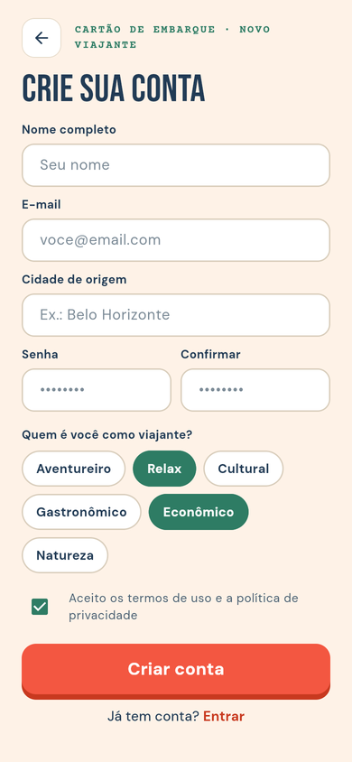
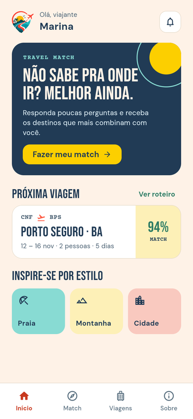
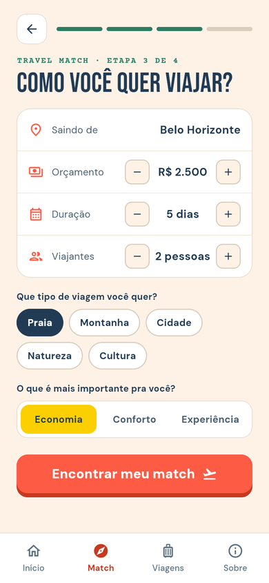
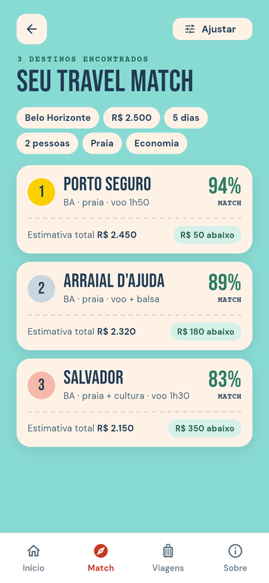
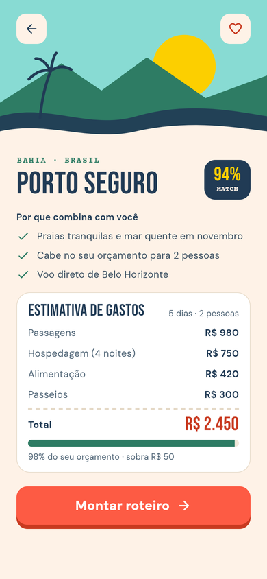
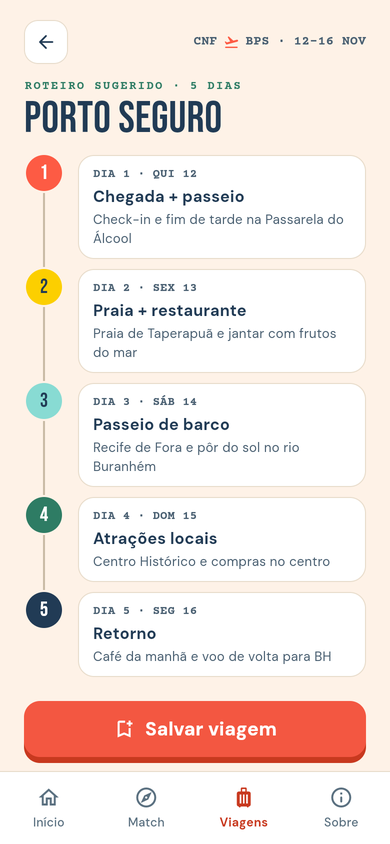
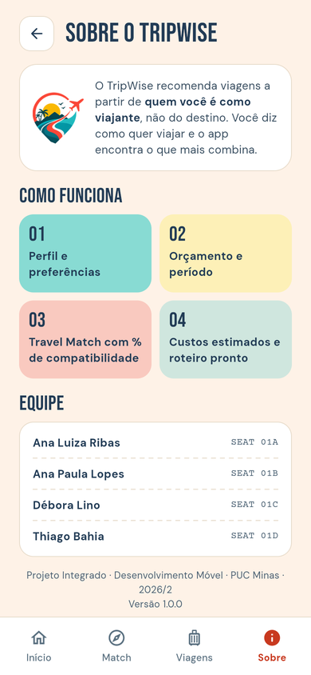

<div align="center">


### Planeje melhor. Viaje mais.

Aplicativo de recomendação e planejamento personalizado de viagens.


</div>

---

## Sobre o projeto

A maioria dos apps de viagem começa pela pergunta *“para onde você quer ir?”*. O **TripWise** inverte essa lógica: o usuário informa **perfil, preferências, orçamento e período**, e o app encontra os destinos mais compatíveis, com estimativa de custos e roteiro sugerido.

> **O usuário não precisa saber para onde quer ir. Ele só precisa saber como quer viajar.**

```text
Perfil + Preferências + Orçamento + Período
                    │
                    ▼
              Travel Match  ──►  destinos ordenados por % de compatibilidade
                    │
                    ▼
     Estimativa de gastos  ──►  Roteiro dia a dia
```

## Telas

| Início | Cadastro | Home | Preferências |
|:---:|:---:|:---:|:---:|
|  |  |  |  |
| **Travel Match** | **Destino** | **Roteiro** | **Sobre** |
|  |  |  |  |

## Funcionalidades (Sprint 2)

- **Onboarding:** splash, tela inicial, login e cadastro com validação de formulário e perfil de viajante
- **Travel Match:** questionário (orçamento, duração, viajantes, tipo de viagem e prioridade) e ranking de destinos por compatibilidade
- **Destino:** motivos do match e estimativa de gastos comparada ao orçamento
- **Roteiro:** planejamento sugerido, dia a dia
- **Navegação:** rotas nomeadas e barra inferior (Início · Match · Viagens · Sobre)

## Persistência (Sprint 3)

- **SQLite** com `sqflite`: 10 tabelas criadas em `lib/data/schema.dart` (usuários, estilos, destinos, custos, roteiro modelo, buscas, viagens, itens do roteiro e favoritos), com chaves estrangeiras e `ON DELETE CASCADE`
- **CRUD** em usuários (cadastro, login, perfil, exclusão de conta), viagens (planejar, listar, editar, excluir) e itens do roteiro (adicionar, editar, concluir, excluir)
- **Sessão** do usuário com `shared_preferences`
- Senhas guardadas como hash SHA-256
- No navegador, o mesmo banco roda com `sqflite_common_ffi_web` (rode `dart run sqflite_common_ffi_web:setup` uma vez)
- Testes do CRUD em banco em memória: `test/database_test.dart`

## Como executar

Pré-requisito: [Flutter SDK](https://docs.flutter.dev/get-started/install) (canal stable).

```bash
flutter pub get
flutter run -d chrome        # ou um emulador/dispositivo Android
flutter test                 # testes de widget
```

## Estrutura

```text
lib/
├── main.dart                # MaterialApp, tema e rotas
├── app_routes.dart          # rotas nomeadas e troca de abas
├── data/                    # banco SQLite, repositórios (CRUD) e sessão
├── models/                  # usuário, destino, viagem e preferências
├── screens/                 # telas do app
├── theme/                   # cores, tipografia e ThemeData
└── widgets/                 # componentes reutilizáveis
assets/
├── fonts/                   # Bebas Neue, DM Sans, Courier Prime
└── images/                  # logo
docs/
├── apresentacao-tripwise.pdf        # apresentação do projeto
├── sprint2-interface-do-app.pdf     # entrega da Sprint 2
├── sprint3-armazenamento-e-persistencia.pdf
└── screenshots/
test/
```

## Entregas

| Etapa | Entrega | Material |
|---|---|---|
| Proposta | Apresentação do projeto | [`docs/apresentacao-tripwise.pdf`](docs/apresentacao-tripwise.pdf) |
| Sprint 2 | Interface do app e navegação em Flutter | [`docs/sprint2-interface-do-app.pdf`](docs/sprint2-interface-do-app.pdf) |
| Sprint 3 | Armazenamento e persistência (SQLite + CRUD) | [`docs/sprint3-armazenamento-e-persistencia.pdf`](docs/sprint3-armazenamento-e-persistencia.pdf) |

## Equipe

Projeto Integrado · Desenvolvimento Móvel · PUC Minas · 2026/2

- Ana Luiza Ribas
- Ana Paula Lopes
- Débora Lino
- Thiago Bahia
